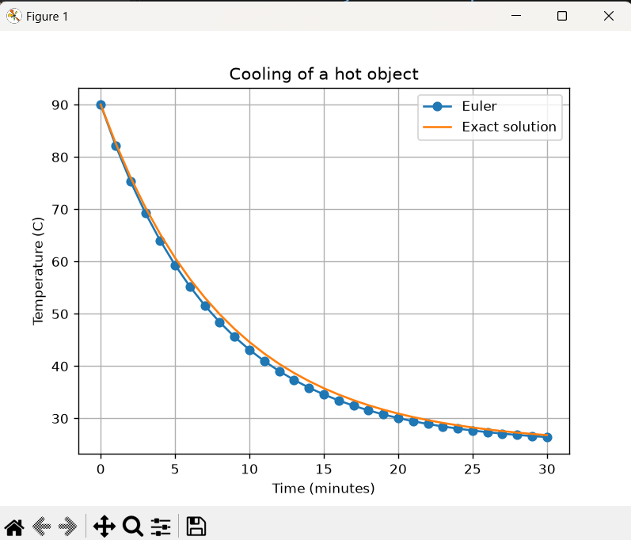
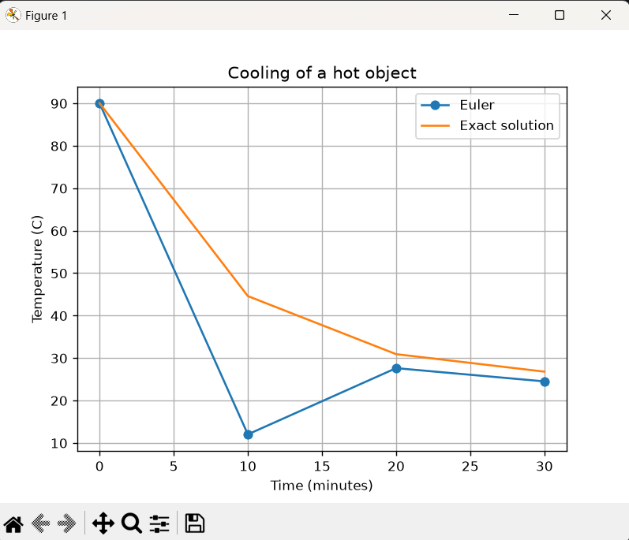
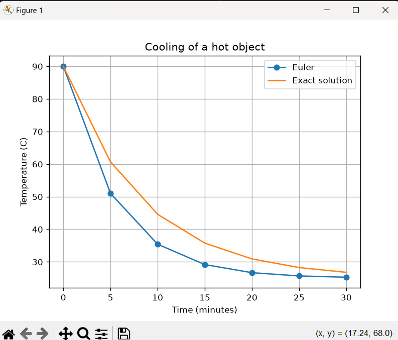
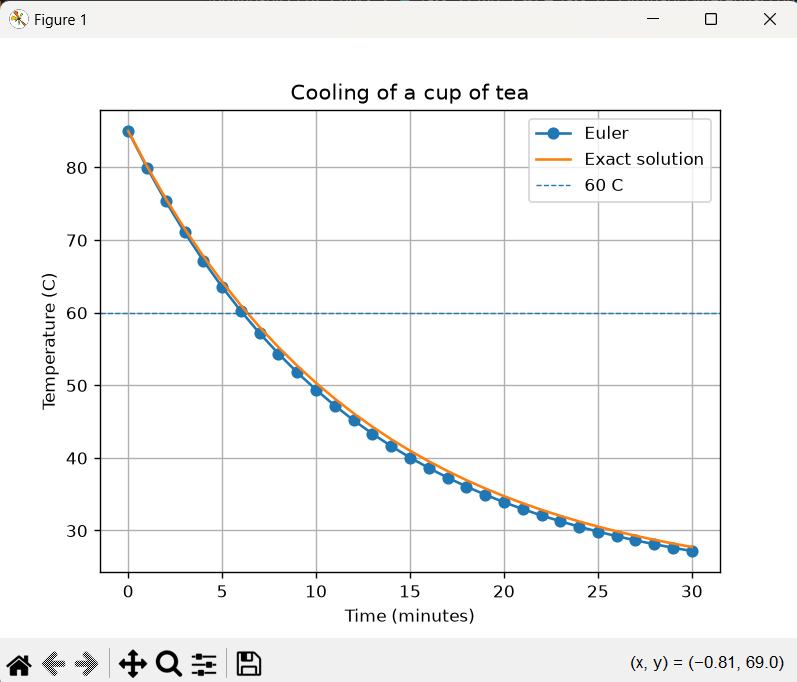

# Task 17: Ordinary Differential Equations - Euler Method

## 1. Problem
A hot object cools in a room. We predict its temperature over 30
minutes using Newton's law of cooling and Euler's method, then compare
the result with the exact solution.

## 2. Inputs and mathematical operation (Requirement B)
- Inputs: ambient temperature 25 C, initial temperature 90 C, cooling constant k = 0.12 per minute, step size h = 1 minute, end time 30 minutes.
- Operation: the cooling law is the ODE dT/dt = -k(T - T_ambient). Euler's method starts at T(0) = 90 and repeats T_new = T_old + h * (-k(T_old - T_ambient)).
- The program also calculates the exact solution T(t) = T_ambient + (T_initial - T_ambient) * e^(-kt) to check the Euler result.

## 3. Original output
```
Euler temperature after 30 min: 26.40 C
Exact temperature after 30 min: 26.78 C
Final absolute error: 0.3720 C
```



## 4. Interpretation of the output and graph (Requirement D)

- The temperature drops quickly at first, then levels off near 25 C.
- This happens because the cooling rate depends on the difference between the object and the room, so cooling slows as the gap shrinks.
- The Euler curve sits slightly below the exact curve, because each step uses the rate from the start of the step, which is steeper than the average rate during the step.
- After 30 minutes the Euler error is 0.37 C (26.40 C against 26.78 C exact).

## 5. Changing a parameter (Requirement C)
- What I changed: the step size h, from 1 minute to 10,5
- Results 
```
Euler temperature after 30 min: 24.48 C
Exact temperature after 30 min: 26.78 C
Final absolute error: 2.2960 C
```

```
Euler temperature after 30 min: 25.27 C
Exact temperature after 30 min: 26.78 C
Final absolute error: 1.5098 C
```


- What changed and why: the error fell as the step got smaller: 2.30 C at h = 10, 1.51 C at h = 5 and 0.37 C at h = 1. A smaller step keeps each straight-line segment closer to the real curve. At h = 10 the Euler curve swings above and below 25 C instead of settling, which is physically impossible and shows that large steps make the method unstable.
## 6. Modified real-world case (Requirement E)
- Scenario: a cup of tea cooling in a room.
- Assumptions: room temperature stays at 22 C, tea starts at 85 C, k = 0.08 per minute (an assumed value for a cup of tea), the cooling follows Newton's law, and there is no stirring or reheating.
- New input data: T_ambient = 22, T_initial = 85, k = 0.08, h = 1 min, end time 30 min.
- New output:
```
Euler temperature after 30 min: 27.16 C
Exact temperature after 30 min: 27.72 C
Final absolute error: 0.5514 C
Tea reaches 60 C after about 7 minutes (Euler)
```


- Interpretation: The tea takes about 7 minutes to cool from 85 C to 60 C. After 30 minutes Euler gives 27.16 C against an exact 27.72 C, so it is close to room temperature (22 C) but still slowly falling. The graph drops steeply at first and then flattens. Euler stays slightly below the exact curve, as in the original case. A limitation is that real cooling depends on the cup, the lid and air movement, so k would have to be measured with a thermometer.


## 7. Conclusion
Euler's method predicts how a quantity changes over time by taking
small straight-line steps, using the current rate of change to find
the next value. In this task, reducing the step size made the answer
more accurate: the error at 30 minutes fell from 2.30 C at h = 10, to
1.51 C at h = 5, to 0.37 C at h = 1. A limitation is that large steps
make the method unstable (at h = 10 the temperature swung above and
below room temperature), and the tea example also depends on a cooling
constant k that would have to be measured in real life.